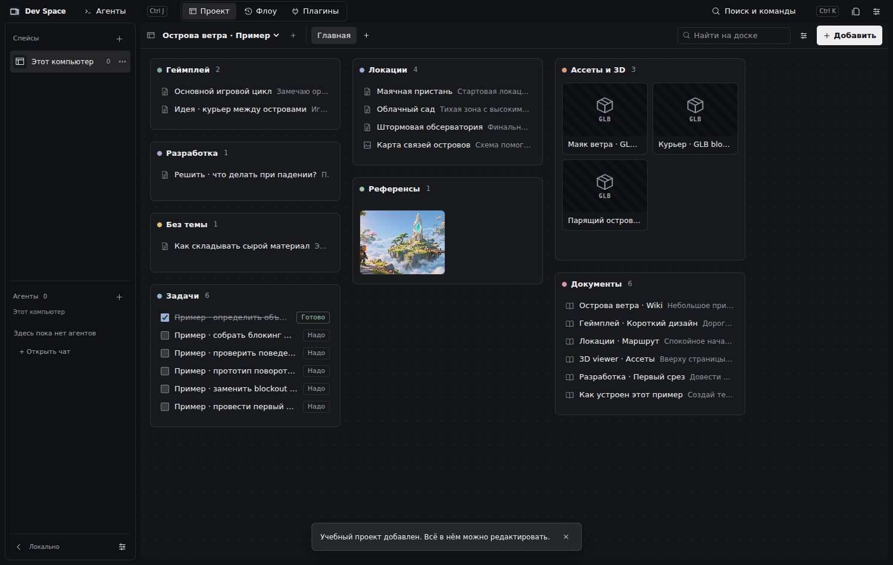
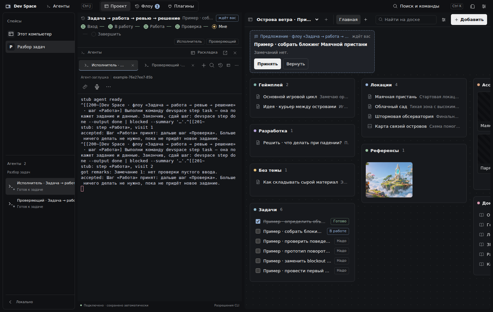
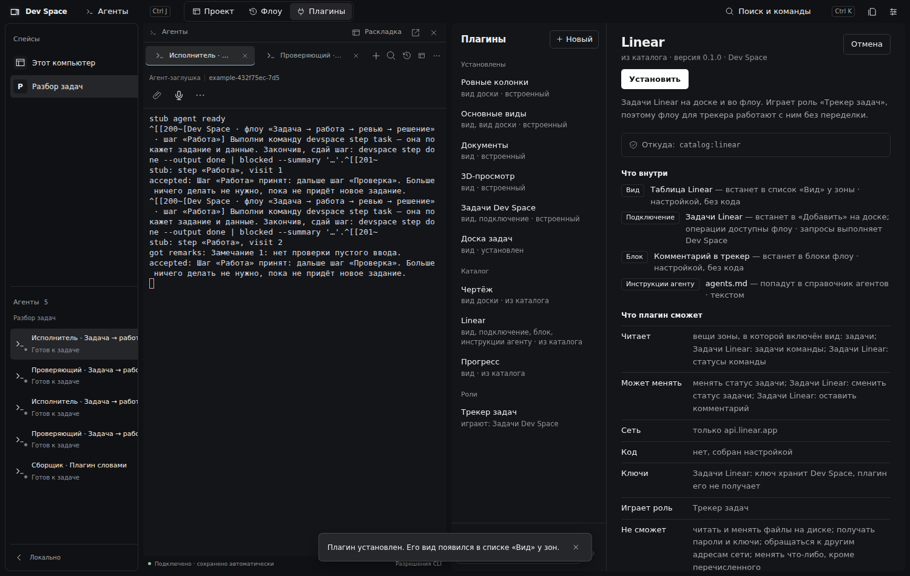
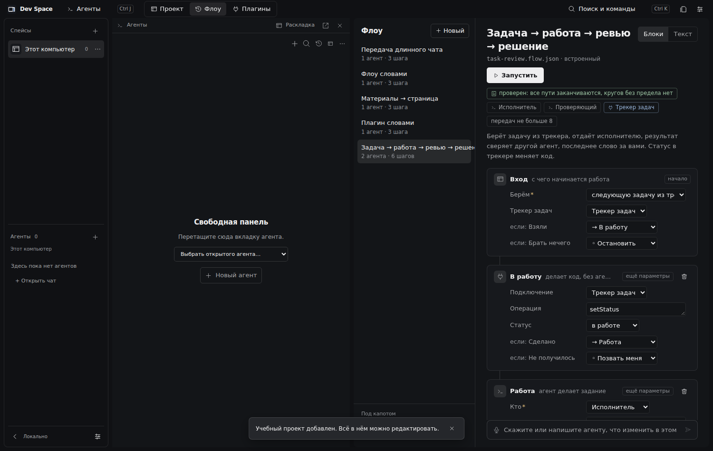
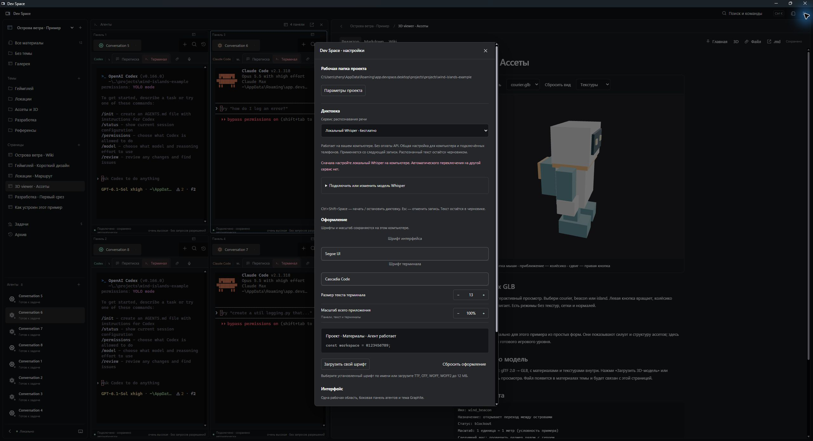

# Dev Space

**Весь проект перед глазами. Агенты — рядом.**

Dev Space — настольное рабочее пространство для разработки игр, приложений, учёбы и рабочих проектов. Слева — CLI-агенты в настоящих терминалах. Справа — доска проекта: заметки, эскизы, документы, 3D-модели и задачи лежат рядом, собранные в зоны.

Написать заметку, перетащить файл, поправить документ или открыть модель можно сразу, без модели. Агент подключается, когда нужно сделать работу: ему отдают то, что видно на доске, или запускают флоу — процесс из блоков, который исполняет код, а не модель.

[Релизы](https://github.com/VllSunday/dev-space/releases) · [Сборка и публикация](RELEASING.md) · [Дизайн интерфейса](DESIGN.md) · [Архитектура доски, плагинов и флоу](docs/redesign/ARCHITECTURE.md) · [Как добавить блок](docs/redesign/BLOCKS.md)

[](docs/redesign/screens/board-overview.png)

*Доска учебного проекта «Острова ветра». Снимки ниже сделаны автоматической проверкой в браузере, а не в окне установленного приложения.*

## Попробуйте готовый проект

При первом запуске нажмите **«Посмотреть пример»**. Ещё один путь: **Новый проект → Открыть учебный проект** или команда **«Открыть учебный проект „Острова ветра“»** через `Ctrl+K`.

Откроется отдельная редактируемая копия игрового проекта: доска с восемью зонами, 12 материалов, шесть документов, три GLB-модели и шесть задач. Можно сразу посмотреть, как устроены зоны, уровни и просмотр моделей. Агент для открытия примера не нужен.

[Исходники учебного шаблона](desktop/service/templates/wind-islands) входят в приложение. Ваши проекты, переписки и настройки в них не копируются.

## Как работать

1. **Создайте проект из готовой раскладки.** «Игра», «Приложение», «Учёба», «Рабочие задачи» или пустая доска: зоны можно переименовать, добавить и убрать.
2. **Накидайте материал.** Перетащите файл в зону, вставьте снимок через `Ctrl+V` в открытой зоне или нажмите «Добавить». Запись сохраняется без модели.
3. **Смотрите на трёх расстояниях.** Вся доска → одна зона вблизи → одна вещь на весь экран. `Alt+←` возвращает на уровень выше. Зоны двигаются, меняют размер, сворачиваются и уходят на нижнюю полку.
4. **Подключите агента, когда он нужен.** Отметьте карточки и нажмите «Отдать агенту»: названия вставятся в терминал без отправки. Или запустите флоу — шаги пойдут сами, а результат ляжет на доску как предложение.

[](docs/redesign/screens/flows-run-waiting.png)

*Флоу дошёл до шага «Мне»: шаги видны над терминалами, предложение лежит на доске пунктиром и ждёт решения.*

## Доска и плагины

Всё, что показывает данные, — плагин: список, плитки, галерея, доска задач, таблица, 3D-просмотр. Встроенные виды описаны тем же `plugin.json`, что и сторонние. Плагин может менять и саму доску — раскладку и оформление.

- **Создать словами.** «Добавить → Описать словами…»: скажите, что хотите видеть и откуда брать данные. Агент соберёт плагин, код проверит его, а вы увидите вид на примере данных вместе с тем, что он читает и что может менять.
- **Установить.** Из каталога, из папки или по ссылке на Git-репозиторий. До установки видно, откуда плагин, что внутри, что он сможет и чего не сможет.
- **Безопасность.** Вид со своим кодом работает в песочнице без диска и без сети. Запросы подключений выполняет само приложение и только к объявленным адресам; ключи плагину не передаются.

[](docs/redesign/screens/plugins-install-preview.png)

## Флоу

Флоу — файл из блоков: кто что делает, в каком порядке и с какими пределами. Его исполняет код. Модель работает внутри шага, но не может перескочить шаг или выбрать выход, которого у блока нет.

- **Блоки:** Вход, Работа, Проверка, Вопрос агенту, Мне, Несколько сразу, Проверка фактов, Действие. Плагин может добавить свои.
- **Проверка перед запуском:** каждый путь заканчивается, каждый круг ограничен пределом возвратов. Сработал предел — флоу останавливается и зовёт вас.
- **Роли, а не имена:** во флоу записаны «Исполнитель» и «Проверяющий», а агенты выбираются при запуске. Так же с сервисами: флоу обращается к роли «Трекер задач», которую играют встроенные задачи или плагин Linear.
- **Сдача шага:** агент сдаёт шаг командой `devspace step done`, а результат проверяет код. Справочник команд и блоков есть у каждого агента: `devspace help`.
- **Правка:** блоками, текстом или словами — это один и тот же файл.

В библиотеке: «Материалы → страница», «Задача → работа → ревью → решение», «Передача длинного чата», «Плагин словами», «Флоу словами».

[](docs/redesign/screens/flows-library.png)

## Что есть внутри

| Работа | Возможности |
|---|---|
| Доска | Зоны и вещи, несколько досок на проект, три уровня, поиск по доске, сворачивание и скрытие зон, готовые раскладки |
| Материалы | Заметки, ссылки, изображения, вложения, архив; карточка — ссылка, вещь может лежать в нескольких зонах |
| Документы | Редактор блоков, Markdown, закреплённые темы и экспорт `.md` |
| Задачи | Чек-лист, доска с колонками или таблица; встроенные задачи играют роль «Трекер задач» |
| Плагины | Виды, виды доски, подключения, блоки флоу, готовые флоу и инструкции агентам; создание словами |
| Флоу | Библиотека, редактор блоками и текстом, проверка перед запуском, полоса шагов над терминалами |
| Спейсы | Независимые локальные группы агентов, названия, цвета и раскладки; флоу можно развернуть в новый спейс |
| 3D | Загрузка GLB, вращение и масштабирование, материалы, сетка и нормали; локальные декодеры |
| Агенты | Codex, Claude Code, Antigravity, OpenCode, Kimi и обычный терминал через установленные CLI |
| Панели | До четырёх областей, перенос вкладок, изменение пропорций и разворачивание одной панели |
| Инструменты | Файлы, навыки и MCP в общей панели с регулируемой шириной и сохранением размера |
| Оформление | Тёмная Graphite-тема, цвета и значки зон, шрифты интерфейса и терминала, загрузка TTF/OTF/WOFF/WOFF2, масштаб окна |
| Диктовка | Локальный Whisper, OpenAI или OpenRouter; распознанный текст остаётся черновиком |

Сворачивание области агентов или удаление панели из раскладки не останавливает агентов. Статусы отражают события сессии: работа, ожидание ответа, непрочитанный результат или остановка. Каждый CLI использует собственный аккаунт и настройки доступа.

## Клавиатура

| Действие | Сочетание |
|---|---|
| Поиск и команды | `Ctrl+K` / `Ctrl+Shift+P` |
| Записать мысль / сохранить запись | `Ctrl+N` / `Ctrl+Enter` |
| Создать зону / проект / страницу | `Ctrl+Shift+N` / `Ctrl+Alt+N` / `Ctrl+Alt+P` |
| Найти на доске | `Ctrl+F` |
| На уровень выше | `Alt+←` |
| Новый агент или терминал | `Ctrl+Shift+T` |
| Показать или свернуть агентов | `Ctrl+J` |
| Разделить вправо / вниз | `Ctrl+Shift+O` / `Ctrl+Shift+E` |
| Убрать панель / развернуть панель | `Ctrl+Shift+X` / `Ctrl+Shift+Z` |
| Свернуть список агентов | `Ctrl+B` |
| Прикрепить файл | `Ctrl+O` |
| Начать или остановить диктовку | `Ctrl+Shift+Space` |
| Отменить запись / закрыть диалог | `Esc` |
| Запустить флоу «Материалы → страница» | `Ctrl+Shift+Enter` |
| Справка клавиш | `Ctrl+/` |

На macOS основные сочетания также доступны с Command. Разделители доступны через Tab и стрелки. Home или двойной щелчок по левому краю панели инструментов возвращает стандартную ширину. Обычные `Ctrl+A` и `Ctrl+Z` внутри редактора сохраняют привычное поведение.

## Whisper и шрифты

В **Настройках → Оформление** можно отдельно выбрать шрифт интерфейса и терминала, загрузить свой файл и изменить масштаб. Настройки применяются без перезапуска терминалов.

<details>
<summary>Посмотреть настройки шрифтов и диктовки</summary>

[](design/readme/appearance.png)

</details>

Для диктовки выберите **Локальный Whisper → Подключить или изменить модель Whisper**:

1. Укажите Python с установленным `faster-whisper`.
2. Выберите папку модели CTranslate2 или её файл `model.bin`.
3. Выберите Авто, CPU или NVIDIA CUDA и нажмите **«Проверить и подключить»**.

Модель проверяется до сохранения настроек. `.pt` и GGUF напрямую не подключаются. Локальный Whisper не требует оплаты API. Автоматического переключения на платный сервис нет.

## Скачать и начать работу

| Платформа | Пакеты релиза |
|---|---|
| Windows x64 | [Релизы: установщик NSIS и portable ZIP](https://github.com/VllSunday/dev-space/releases/latest) |
| Linux x86_64 | [Релизы: AppImage и portable tar.gz](https://github.com/VllSunday/dev-space/releases/latest) |
| macOS Apple Silicon | [Релизы: DMG и архив arm64](https://github.com/VllSunday/dev-space/releases/latest) |
| macOS Intel | [Релизы: DMG и архив x64](https://github.com/VllSunday/dev-space/releases/latest) |

Для переносного запуска распакуйте весь архив: исполняемый файл использует соседнюю папку `runtime`. Отдельный launcher предназначен для обновления существующего комплекта. macOS-пакеты используют ad-hoc подпись и не имеют Apple notarization. Доступ с телефона работает через сопряжение с компьютером и браузер; отдельные APK/IPA в релиз не входят.

Каждая платформа собирается на своём GitHub Actions runner. Релиз публикуется после успешного завершения всех сборок; контрольные суммы находятся в `SHA256SUMS.txt`.

Агенты используют установленные на компьютере CLI и их обычный вход в аккаунт. При первом запуске создайте проект, выберите его папку и откройте агента через `Ctrl+Shift+T`. Само приложение не включает подписки провайдеров.

## Данные

```text
workspace/devspace/
  space.json       # проекты, доски, темы, материалы, страницы и задачи
  drafts.json      # незавершённый ввод
  assets/          # оригиналы вложений
  proposals/       # результаты агентов для проверки: страницы, плагины, флоу
  plugins/         # установленные плагины
  flows/           # свои и изменённые флоу
  history/         # последние состояния для отмены
.devspace/         # настройки, терминальные сессии, ключи подключений, запуски флоу
```

Проекты, сохранённые до появления досок, открываются без потерь: при первом запуске к ним добавляется доска, а материалы, страницы и задачи остаются как были. Копия файла до изменения лежит в `space.before-boards.json`.

Материалы хранятся локально. Передача контекста агенту или внешнему провайдеру выполняется выбранным действием пользователя и подчиняется настройкам соответствующего CLI. Запись страниц проверяет версию, чтобы устаревший результат не затёр более новую правку.

API-ключи, CLI-логины, переписки, личные проекты, личные примеры и веса моделей исключены из Git и пакетов приложения. Публичный учебный шаблон «Острова ветра» включён отдельно.

## Разработка

Требуются Node.js 22.20+, npm и Rust. Для Windows нужен MSVC; системные зависимости Linux и macOS указаны в [workflow](.github/workflows/release-build.yml).

```sh
npm ci
npm run build
npm test
npm run desktop:dev
```

Для пакета приложения: `npm run desktop:build`. Подготовка Node runtime, интерфейса и ресурсов запускается автоматически через `desktop/prepare.mjs`.

Проверки интерфейса после `npm run build`:

```sh
node checks/layout-ui.mjs
node checks/workbench-ui.mjs
node checks/viewer-ui.mjs
node checks/wiki-navigation-ui.mjs
node checks/template-ui.mjs
node checks/board-ui.mjs     # доска, плагины, песочница
node checks/flows-ui.mjs     # флоу с агентом-заглушкой в настоящих терминалах
```

Флоу с настоящим CLI-агентом (нужен установленный и авторизованный агент, тратит его лимит): `node checks/flows-real-agent.mjs claude --bypass`.

Выполненные проверки и их ограничения записаны в [VERIFICATION.md](checks/VERIFICATION.md). MIT-лицензия и уведомления о зависимостях — в [LICENSE](LICENSE) и [THIRD_PARTY_NOTICES.md](THIRD_PARTY_NOTICES.md).
