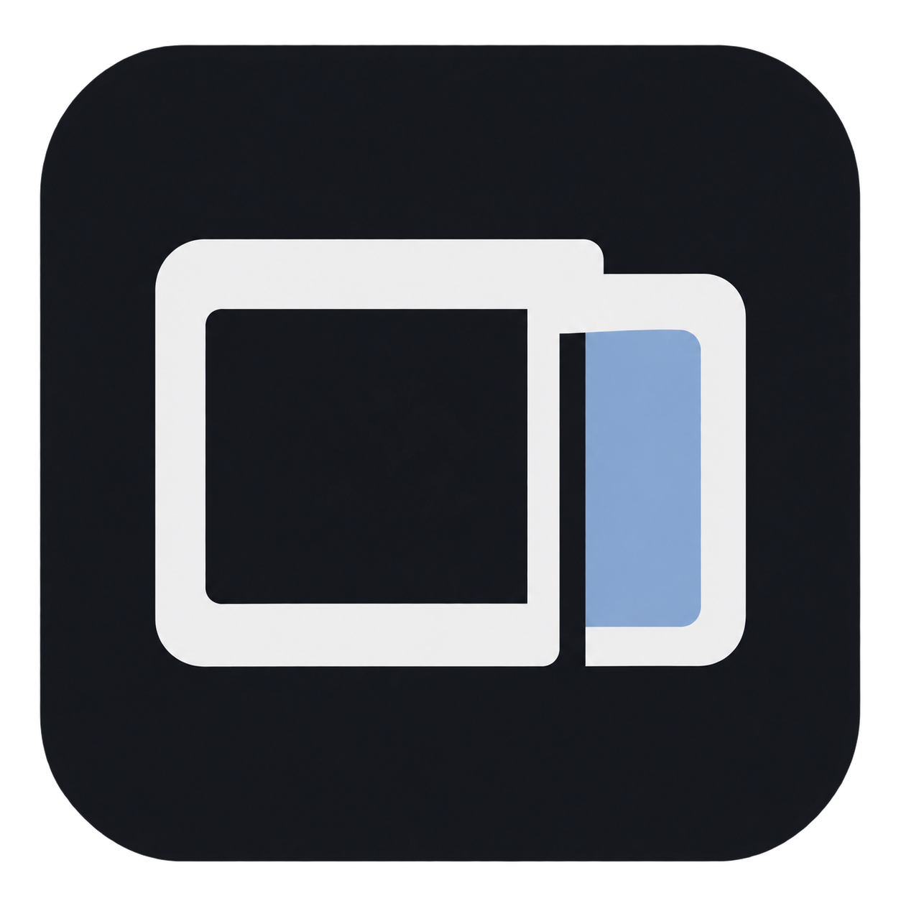

# Dev Space

**Проекты, материалы и CLI-агенты — в одном рабочем окне.**

Собирайте идеи, скриншоты и файлы, оформляйте страницы и продолжайте работу с агентами рядом. Подходит для разработки игр, приложений и рабочих проектов. Основные действия выполняются сразу, без запроса к модели.

[Релизы](https://github.com/VllSunday/dev-space/releases) · [Сборка и публикация](RELEASING.md) · [Дизайн интерфейса](DESIGN.md)


*Схема рабочего окна в Graphite-теме. Личные проекты, переписки и локальные демонстрационные материалы в репозиторий не входят.*

## Как работать

1. **Создайте проект и тему.** Тема собирает материалы одной части работы: интерфейс, механики, исследования или проверки.
2. **Накидайте материал.** Пишите заметки, вставляйте скриншоты через `Ctrl+V`, перетаскивайте файлы или выбирайте их с диска. `Ctrl+Enter` сохраняет запись, обычный Enter переносит строку. Черновики сохраняются отдельно для каждой темы.
3. **Соберите страницу.** Редактируйте блоки или Markdown, добавляйте изображения и используйте Wiki для обзора проекта. Страницу можно назначить главной.
4. **Подключите агента, когда он нужен.** Выделите материалы и выберите «Собрать страницу с агентом». Задание вставится в терминал без отправки. Результат можно проверить перед применением; исходные записи сохраняются.

## Что есть внутри

| Работа | Возможности |
|---|---|
| Материалы | Заметки, ссылки, изображения, вложения, темы, архив и поиск |
| Страницы | Редактор блоков, Markdown, Wiki, изображения и экспорт `.md` |
| 3D | Загрузка GLB, вращение и масштабирование, материалы, сетка и нормали; локальные декодеры |
| Агенты | Codex, Claude Code, Antigravity, OpenCode, Kimi и обычный терминал через установленные CLI |
| Панели | До четырёх областей, перенос вкладок, изменение пропорций и разворачивание одной панели |
| Инструменты | Файлы, навыки и MCP в общей панели с регулируемой шириной и сохранением размера |
| Оформление | Тёмная Graphite-тема, отдельные шрифты интерфейса и терминала, загрузка TTF/OTF/WOFF/WOFF2, масштаб окна |
| Диктовка | Локальный Whisper через Python и модель CTranslate2; текст остаётся черновиком |
| Задачи | Конкретные действия со статусами и ссылками на исходные материалы |

Сворачивание области агентов или удаление панели из раскладки не останавливает агентов. Статусы отражают события сессии: работа, ожидание ответа, непрочитанный результат или остановка. Каждый CLI использует собственный аккаунт и настройки доступа.

## Клавиатура

| Действие | Сочетание |
|---|---|
| Поиск и команды | `Ctrl+K` / `Ctrl+Shift+P` |
| Записать мысль / сохранить запись | `Ctrl+N` / `Ctrl+Enter` |
| Создать тему / проект / страницу | `Ctrl+Shift+N` / `Ctrl+Alt+N` / `Ctrl+Alt+P` |
| Новый агент или терминал | `Ctrl+Shift+T` |
| Показать или свернуть агентов | `Ctrl+J` |
| Разделить вправо / вниз | `Ctrl+Shift+O` / `Ctrl+Shift+E` |
| Убрать панель / развернуть панель | `Ctrl+Shift+X` / `Ctrl+Shift+Z` |
| Свернуть навигацию | `Ctrl+B` |
| Прикрепить файл | `Ctrl+O` |
| Начать или остановить диктовку | `Ctrl+Shift+Space` |
| Отменить запись / закрыть диалог | `Esc` |
| Подготовить задание агенту | `Ctrl+Shift+Enter` |
| Справка клавиш | `Ctrl+/` |

На macOS основные сочетания также доступны с Command. Разделители доступны через Tab и стрелки. Home или двойной щелчок по левому краю панели инструментов возвращает стандартную ширину. Обычные `Ctrl+A` и `Ctrl+Z` внутри редактора сохраняют привычное поведение.

## Whisper и шрифты

В **Настройках → Оформление** можно отдельно выбрать шрифт интерфейса и терминала, загрузить свой файл и изменить масштаб. Настройки применяются без перезапуска терминалов.

Для диктовки выберите **Локальный Whisper → Подключить или изменить модель Whisper**:

1. Укажите Python с установленным `faster-whisper`.
2. Выберите папку модели CTranslate2 или её файл `model.bin`.
3. Выберите Авто, CPU или NVIDIA CUDA и нажмите **«Проверить и подключить»**.

Модель проверяется до сохранения настроек. `.pt` и GGUF напрямую не подключаются. Локальный Whisper не требует оплаты API. Автоматического переключения на платный сервис нет.

## Платформы и установка

| Платформа | Пакеты релиза |
|---|---|
| Windows x64 | Установщик NSIS и portable ZIP с runtime |
| Linux x86_64 | AppImage и portable tar.gz с runtime |
| macOS Apple Silicon | DMG и архив приложения arm64 |
| macOS Intel | DMG и архив приложения x64 |

Для переносного запуска распакуйте весь архив: исполняемый файл использует соседнюю папку `runtime`. Отдельный launcher предназначен для обновления существующего комплекта. macOS-пакеты используют ad-hoc подпись и не имеют Apple notarization. Доступ с телефона работает через сопряжение с компьютером и браузер; отдельные APK/IPA в релиз не входят.

Каждая платформа собирается на своём GitHub Actions runner. Релиз публикуется после успешного завершения всех сборок; контрольные суммы находятся в `SHA256SUMS.txt`.

## Данные

```text
workspace/devspace/
  space.json       # проекты, темы, материалы, страницы и задачи
  drafts.json      # незавершённый ввод
  assets/          # оригиналы вложений
  proposals/       # результаты агентов для проверки
  history/         # последние состояния для отмены
.devspace/         # настройки и терминальные сессии
```

Материалы хранятся локально. Передача контекста агенту или внешнему провайдеру выполняется выбранным действием пользователя и подчиняется настройкам соответствующего CLI. Запись страниц проверяет версию, чтобы устаревший результат не затёр более новую правку.

API-ключи, CLI-логины, переписки, личные проекты, локальные примеры и веса моделей исключены из Git и обычных пакетов приложения.

## Разработка

Требуются Node.js 22.20+, npm и Rust. Для Windows нужен MSVC; системные зависимости Linux и macOS указаны в [workflow](.github/workflows/release-build.yml).

```sh
npm ci
npm run build
npm test
npm run desktop:dev
```

Для пакета приложения: `npm run desktop:build`. Подготовка Node runtime, интерфейса и ресурсов запускается автоматически через `desktop/prepare.mjs`.

Проверки интерфейса после `npm run build`:

```sh
node checks/layout-ui.mjs
node checks/workbench-ui.mjs
node checks/viewer-ui.mjs
```

Выполненные проверки и их ограничения записаны в [VERIFICATION.md](checks/VERIFICATION.md). MIT-лицензия и уведомления о зависимостях — в [LICENSE](LICENSE) и [THIRD_PARTY_NOTICES.md](THIRD_PARTY_NOTICES.md).
