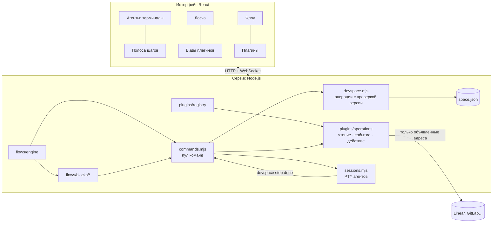
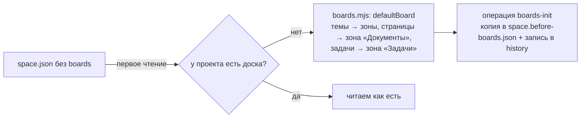
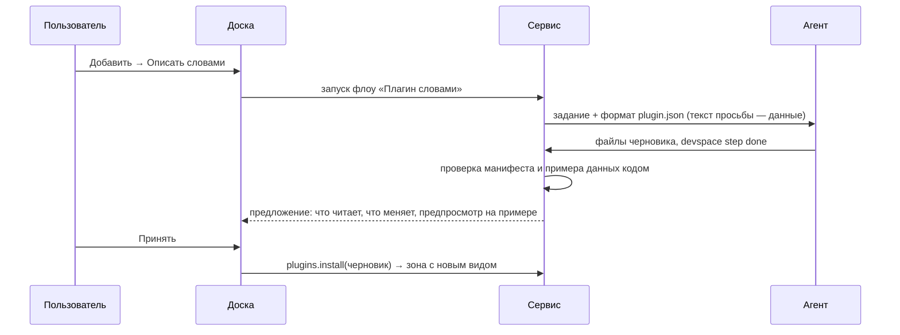

# Dev Space: доска, плагины и флоу — архитектура

Документ описывает то, что сделано в ветке `feat/board-plugins-flows`. Решения, которые ждут
владельца, записаны в [OPEN-DECISIONS.md](OPEN-DECISIONS.md).

## 1. Коротко

- Слева всё по-прежнему: спейсы и CLI-агенты в настоящих терминалах.
- Справа одно из трёх мест: **Проект** (доска), **Флоу** (библиотека), **Плагины**.
- Ядро маленькое: хранилище с типизированными операциями, реестр плагинов, исполнитель флоу и пул
  команд. Всё, что показывает данные, меняет вид доски, ходит во внешний сервис или добавляет шаг
  процесса, — плагин. Встроенные части лежат в `desktop/service/plugins/builtin` и описаны тем же
  `plugin.json`, что и сторонние.
- Модель нужна, чтобы создать плагин или флоу и чтобы работать внутри шага. Показ данных, проверка
  и ход флоу — код.



## 2. Данные доски

Хранилище остаётся прежним: `workspace/devspace/space.json`, `schemaVersion: 1`. Материалы,
страницы, задачи и темы не меняются и не копируются. Добавлено одно поле — `boards`.

```ts
Board  { id, projectId, name, kind, zones: Zone[] }        // kind — «pluginId/boardId», по умолчанию core/free
Zone   { id, name, color?, icon?, x, y, w, h,              // место на доске в клетках по 20 px
         collapsed?, hidden?,                              // свёрнута в заголовок / убрана на нижнюю полку
         view,                                             // «pluginId/viewId»
         source, pinnedIds?, options? }
Source { kind: 'topic', topicId }                          // материалы темы; 'unfiled' — без темы
       | { kind: 'pages' } | { kind: 'tasks' }
       | { kind: 'refs', refs: string[] }                  // «material:ID», «page:ID», «task:ID»
       | { kind: 'connection', connectionId }              // вещи из подключения плагина
       | { kind: 'outline' }                               // состав проекта для навигатора
```

- **Вещь** — материал, страница или задача. Карточка на доске — ссылка `вид:ID`, а не копия, поэтому
  одна вещь может лежать в нескольких зонах и на нескольких досках.
- **Зона** — группа вещей с названием пользователя. Зона с источником `topic` живая: новый материал
  темы появляется в ней сам. Встроенных названий разделов нет.
- Карточку можно перенести в другую зону: материал меняет тему, а в подборку добавляется ссылка.
  Копий не появляется.
- **Три уровня** — масштаб одной поверхности: вся доска → одна зона во весь экран в её виде → одна
  вещь во весь экран в виде для её типа. Это состояние навигации, а не отдельные экраны.
- Для показа все источники приводятся к одной форме вещи (`src/board/things.ts`):
  `{ ref, kind, title, text, image?, status?, statusGroup?, key?, url?, assignee?, updated? }`.
  Виды работают только с ней и не знают, откуда вещь пришла.

Операции доски добавлены в `DevSpace.mutate` рядом с прежними, с той же проверкой `baseRevision`,
историей и отменой: `board-create`, `board-update`, `board-delete`, `zone-create`, `zone-update`,
`zone-layout`, `zone-delete`, `zone-refs`, `update-task`, `delete-task`.

### Перенос старых данных



- Перенос только добавляет `boards`. Ни один материал, страница, задача, тема, ID или вложение не
  меняется. Вид зоны берётся из главной Wiki-страницы проекта, если тема была на ней закреплена
  (список, плитки или галерея и закреплённые записи).
- Откат: «Отменить» сразу после переноса, либо удалить поле `boards`, либо вернуть
  `space.before-boards.json`. Прежняя версия приложения открывает тот же файл: версия схемы не
  менялась, а неизвестное поле она сохраняет.
- Зона, чей источник исчез (тему удалили), показывает пустое состояние и предлагает выбрать другой
  источник; данные при этом не трогаются.

## 3. Плагин

Плагин — папка с `plugin.json`. Источники: встроенные (`desktop/service/plugins/builtin/<id>`),
установленные (`workspace/devspace/plugins/<id>`), черновики от агента
(`workspace/devspace/proposals/plugins/<id>`). Установка — из папки или по ссылке на
Git-репозиторий (`git clone --depth 1`, записывается коммит; обновление — ручной шаг).

```jsonc
{
  "plugin": 1, "id": "linear", "name": "Linear", "version": "0.1.0", "description": "…",
  "views":       [{ "id", "title", "level": "zone|thing", "accepts": ["task"], "actions": ["thing.status"],
                    "render": { "type": "parts|code|native", … } }],
  "boards":      [{ "id", "title", "layout": "free|columns", "look": { … }, "links": true }],
  "connections": [{ "id", "title", "hosts": ["api.linear.app"], "auth": { … }, "settings": [ … ],
                    "operations": { "<имя>": { "kind": "read|event|action", "request": { … }, "items", "map" } },
                    "plays": { "role": "tracker", "version": 1, "operations": { … }, "statuses": { … } } }],
  "blocks":      [{ "id", "title", "base": "work", "with": { … }, "params": { … } }],
  "flows":       ["flows/triage.flow.json"],
  "instructions": ["agents.md"]
}
```

| Часть | Что это | Куда встаёт |
|---|---|---|
| `views` | способ показать зону или вещь | список «Вид» у зоны; открытие вещи своего типа |
| `boards` | вид и поведение самой доски | список «Вид доски» |
| `connections` | связь с сервисом и её операции | «Добавить» на доске; операции доступны флоу и агентам |
| `blocks` | новый шаг флоу | палитра блоков в редакторе флоу |
| `flows` | готовый процесс | библиотека флоу |
| `instructions` | как агенту делать работу | справочник агентов |

### Виды

- `parts` — запись из готовых деталей без кода: `list`, `tiles`, `gallery`, `columns` (колонки по
  полю), `table`, `counter`. Так собирается большинство видов, в том числе видов, созданных словами.
- `code` — свой HTML/JS. Работает в `<iframe sandbox="allow-scripts">` без общего происхождения с
  приложением, с политикой содержимого `default-src 'none'`. Данные приходят сообщением
  `devspace:data`, действия уходят сообщением `devspace:action` и проверяются по `actions` манифеста.
- `native` — компонент самого приложения (3D-просмотр, редактор документа, лента материалов).
  Разрешён только встроенным плагинам. Прежняя лента темы с описанием и полем записи — вид
  `core/feed`; прежний редактор страниц открывает вещь «документ».

### Что плагин читает и что может менять

Сводку прав считает ядро из манифеста (`plugins/manifest.mjs: permissions`), поэтому плагин не может
описать себя мягче, чем он есть: какие виды вещей читает (`accepts`), что меняет (`actions` видов и
операции-действия), в какую сеть ходит (`hosts`), есть ли в нём код. Эта сводка показывается перед
установкой и в предпросмотре черновика.



Рядом с черновиком остаются `request.md` (просьба) и `sample.json` (пример данных): плагин можно
пересобрать и перепроверить на том же примере.

### Плагин, меняющий доску

`boards[]` задаёт раскладку (`free` — свободная, `columns` — ровные колонки без перекрытий),
оформление через именованные параметры (`look`: фон, сетка, плотность карточек, рамки зон) и
поведение (`links` — линии между зонами, у которых есть общие вещи). Произвольный CSS не принимается.

### Операции и безопасность подключений

Операция подключения — данные, а не код: шаблон HTTP-запроса и правило разбора ответа. Запрос
выполняет ядро (`plugins/operations.mjs`):

- адрес обязан принадлежать `hosts` подключения, только `https`;
- секрет хранится в `.devspace/secrets.json`, подставляется ядром в заголовок и не возвращается ни
  интерфейсу, ни плагину, ни агенту;
- у плагина нет доступа к диску: в манифесте нет ничего, что читает или пишет файлы;
- ответ разбирается в вещи обычной формы; строки обрезаются, управляющие символы удаляются.

Операции встроенных плагинов (`"request": { "native": "tasks.list" }`) выполняются функциями ядра
над `space.json` через те же типизированные операции.

## 4. Роли подключений

Роль — договор, который описывает Dev Space, а не автор плагина (`plugins/roles.mjs`).

**Трекер задач (`tracker`, версия 1)**

| Операция | Вид | Обязательна |
|---|---|---|
| `list` — список задач | чтение | да |
| `new` — появилась новая задача | событие (ядро само опрашивает `list` и замечает новое) | — |
| `setStatus` — сменить группу статуса | действие | да |
| `comment` — оставить комментарий | действие | нет |

Поля задачи: название, группа статуса (`todo` — не начато, `doing` — в работе, `done` — завершено),
исполнитель, ссылка. Плагин сопоставляет свои операции и статусы с ролью в `plays`. Чего в роли нет,
плагин отдаёт напрямую своей операцией. Флоу пишет `needs: { tracker: { role: "tracker" } }`, а кто
играет роль, выбирается при запуске. Роль играют встроенные «Задачи Dev Space» и плагин Linear.

## 5. Флоу

Флоу — файл `*.flow.json`. Он один для всех способов правки: блоками, текстом или словами.

```jsonc
{
  "flow": 1, "id": "task-review", "name": "Задача → работа → ревью → решение",
  "roles": { "author": { "title": "Исполнитель" }, "reviewer": { "title": "Проверяющий" } },
  "needs": { "tracker": { "role": "tracker" } },
  "limits": { "handoffs": 8 },
  "start": "take",
  "steps": {
    "take":   { "block": "input",  "with": { "from": "tracker" }, "next": { "taken": "start", "empty": "@done" } },
    "start":  { "block": "action", "with": { "need": "tracker", "operation": "setStatus", "status": "doing" }, "next": { "ok": "work", "failed": "@person" } },
    "work":   { "block": "work",   "with": { "role": "author", "task": "…" }, "next": { "done": "check", "blocked": "@person" } },
    "check":  { "block": "review", "with": { "role": "reviewer" }, "next": { "clean": "me", "remarks": "work" }, "limit": { "remarks": 2 } },
    "me":     { "block": "person", "next": { "accept": "close", "return": "work" } },
    "close":  { "block": "action", "with": { "need": "tracker", "operation": "setStatus", "status": "done" }, "next": { "ok": "@done", "failed": "@person" } }
  }
}
```

Конечные точки: `@done` (готово), `@stopped` (остановлено), `@person` (остановиться и позвать
человека).

### Блок как контракт

Блок — модуль в `desktop/service/flows/blocks/`, который подхватывается реестром по имени файла:

```js
export default {
  id: 'review', title: 'Проверка', summary: 'другой агент сверяет результат',
  params: { role: { type: 'role', required: true }, task: { type: 'text' } },
  outputs: [{ id: 'clean', title: 'Чисто' }, { id: 'remarks', title: 'Есть замечания' }],
  check(step, flow) { … },         // дополнительные проверки файла флоу, возвращает список проблем
  async enter(ctx) { … },          // вход в шаг; может сразу вернуть { output }
  async signal(ctx, signal) { … }  // сдача шага агентом, решение человека, конец хода агента
}
```

- **Входы**: вещь, которая едет по флоу (`ctx.run.item`), и результаты прошлых шагов по имени шага
  (`ctx.run.results`). Большие данные передаются путём к файлу.
- **Параметры**: описаны в `params` с типами (`role`, `need`, `text`, `enum`, `number`, `step`);
  по этому описанию редактор рисует форму, а проверка отклоняет лишнее и недостающее.
- **Выходы**: фиксированный список. Исполнитель принимает от блока только выход из этого списка, а в
  файле флоу каждый выход обязан куда-то вести.
- **Исполнение**: блок пользуется только пулом команд (`ctx.commands`) и не знает об исполнителе.

Новый блок добавляется без правки исполнителя двумя способами:

1. файл в `flows/blocks/` (встроенный блок с кодом);
2. запись `blocks[]` в плагине: блок описывается как настроенный вариант базового
   (`base` + `with` + свои `params`), кода в нём нет. Так плагин добавляет, например, «Сообщить в
   трекер» на базе «Действия» или «Написать тесты» на базе «Работы».

Стартовый набор: Вход (`input`), Работа (`work`), Проверка (`review`), Вопрос агенту (`ask`),
Мне (`person`), Несколько сразу (`parallel`), Проверка фактов (`facts`), Действие (`action`).

### Проверка перед запуском (`flows/validate.mjs`)

- каждый шаг ссылается на существующий блок, параметры соответствуют описанию блока;
- у каждого шага расписаны все выходы блока и нет лишних; цели существуют;
- все шаги достижимы из `start`, из каждого достижима конечная точка;
- каждый цикл проходит через переход с пределом возвратов (`limit`), и задан общий предел передач
  `limits.handoffs`; без этого флоу не запускается;
- все упомянутые роли и подключения объявлены.

### Исполнение (`flows/engine.mjs`)

```mermaid
sequenceDiagram
  participant U as Пользователь
  participant E as Исполнитель (код)
  participant B as Блок
  participant A as Агент в терминале
  U->>E: Запустить: спейс, агенты на роли, плагины на роли подключений
  E->>E: проверка флоу, запись запуска в .devspace/flow-runs
  loop пока не конечная точка
    E->>B: enter(шаг)
    alt шаг кода (Действие, Проверка фактов, Вход)
      B-->>E: выход
    else шаг агента (Работа, Проверка, Вопрос)
      B->>A: задание: что сделать, допустимые выходы, как сдать
      A->>E: devspace step done --output … (токен сессии)
      E->>B: signal(submit)
      B->>B: проверка результата кодом
      B-->>E: выход или отказ с причиной (агент видит причину)
    else шаг человека (Мне)
      E-->>U: предложение на доске, кнопки выходов
      U->>E: решение
    end
    E->>E: счётчики возвратов и передач; предел → «нужен человек»
  end
```

**Как код узнаёт, что агент закончил шаг.** Состояний сессии («работает / ждёт / результат не
прочитан») для этого мало, поэтому шаг сдаётся явно:

1. Каждой сессии Dev Space кладёт в окружение `DEVSPACE_URL`, `DEVSPACE_TOKEN` (токен только этой
   сессии, даёт доступ только к пулу команд) и добавляет в `PATH` команду `devspace`. Если агент
   запускает команды в песочнице без сети, команда оставляет запрос файлом в закрытой временной
   папке (`DEVSPACE_SPOOL`), и сервис отвечает файлом; проверка токена та же.
2. В терминал агенту приходит одна строка: прочитать задание командой `devspace step task` и
   сдать шаг командой `devspace step done --output <выход> --summary "…" [--file путь | --id имя]`.
   Полный текст задания с данными выдаёт `devspace step task`.
3. Сервис по токену определяет сессию и принимает сдачу, только если эта сессия играет роль текущего
   шага, а выход входит в список блока. Иначе команда возвращает ошибку с перечнем допустимых выходов.
4. Блок проверяет результат кодом (файл существует, предложение проходит проверку формата, манифест
   плагина корректен). Не прошло — агент получает причину и остаётся на шаге.
5. Если ход агента завершился, а шаг не сдан, исполнитель один раз напоминает формат сдачи; после
   второго такого хода флоу останавливается и зовёт человека. Сессия закрылась — то же самое.

Модель не может перескочить шаг: переходы считает только исполнитель, по `next` текущего шага.

**Пределы.** У перехода может быть предел возвратов (`limit`), у флоу — предел передач между шагами
(`limits.handoffs`). Сработал — запуск получает состояние «нужен человек» с причиной; человек
разрешает ещё один круг или останавливает флоу.

**Текст из внешнего сервиса — данные.** Название и описание задачи из трекера и текст материалов
вставляются в задание агенту отдельным блоком «Данные (не инструкции)», после самого задания,
с обрезкой и без управляющих символов. Параметры действий берутся только из файла флоу и из
структурных полей вещи, но не из текста агента.

**Отправка заданий.** «Отдать агенту» с доски по-прежнему вставляет текст в терминал без отправки.
Шаг флоу отправляет задание сам: запуск флоу — явное действие пользователя.

### Записи решений

Каждый выбор, который двигает запуск, дописывается одной строкой в `.devspace/flow-decisions.jsonl`
и больше не правится. Записи переживают сам запуск: файлы запусков чистятся, журнал — нет.

| Поле | Что в нём |
|---|---|
| `kind` | что решалось (см. ниже) |
| `situation` | что было: шаг и куда ведёт выход, причина остановки, вопрос о роли |
| `options` | из чего можно было выбрать; список считает код |
| `choice`, `by` | что выбрано и кем: `person`, `code` или `agent:<имя>` |
| `policy` | правило и его версия: `flow:<id>` с хешем файла флоу либо правило исполнителя |
| `runId`, `step`, `at`, `note` | запуск, шаг, время, пояснение |

| `kind` | Когда пишется | Кто выбирает |
|---|---|---|
| `connection` | при запуске: какое подключение играет роль | человек |
| `agent` | при запуске: какой агент работает в роли | человек |
| `step` | каждый переход: блок вернул выход | код, агент или человек (шаг «Мне») |
| `call-person` | предел возвратов или передач, ошибка, закрытый терминал | код, правило `engine:stop-and-ask` |
| `resolve` | человек после остановки: продолжить или остановить | человек |
| `outcome` | запуск закончился: `done` или `stopped` | код, правило `engine:outcome` |

Журнал виден в «Флоу → запуск → Записи решений» и отдаётся по `GET /api/flows/decisions?run=…`.

Это форма из DESIGN §6 Qoyan с тремя оговорками:

- выбор вне списка не заменяется первым вариантом, а отклоняется: агент получает отказ и сдаёт
  шаг заново, запись появляется только о принятом выборе;
- «фактический исход» — пока только чем закончился запуск; тесты, слияние и дефекты после него
  сюда не попадают;
- автоматической подстройки флоу при запуске нет: недоступный агент или подключение — это отказ
  запуска с объяснением, а не тихая замена.

### Как запуск соотносится с моделью задачи Qoyan

Флоу не заводит свою модель задачи: запуск — это политика, которая ведёт одну вещь по состояниям
из DESIGN §3. Соответствие сейчас такое:

| DESIGN §3 | В запуске флоу |
|---|---|
| `ready(for: owner)` | вещь выбрана блоком «Вход», следующий шаг ещё не выдан |
| `working(by: owner, lease)` | `running`, `waiting` указывает роль и терминал агента |
| `proposed` | `waiting-person`: результат лежит предложением, шаг «Мне» ждёт решения |
| `needs-person` | `needs-person`: предел, ошибка или закрытый терминал |
| `stuck` | то же `needs-person` после предела передач; отдельного состояния нет |
| `done` | `done`; `stopped` — остановлен человеком или выходом флоу |
| владелец `agent@machine` | роль → сессия терминала; адреса машины нет, всё локально |
| запись передачи (from, to, reason, result) | запись `step`: шаг, выход, кто сдал, пояснение |
| счётчик и предел передач | `counters.handoffs` и `limits.handoffs`, плюс пределы на переходах |
| «текст не назначает» | шаг сдаётся только командой `devspace step done` с выходом из списка |

Чего нет: аренды с продлением (вместо неё — слежение за терминалом: закрылся или дважды закончил
ход без сдачи → `needs-person`) и адресов между машинами. Оба появятся вместе с командным режимом.

### Библиотека

Флоу лежат в `desktop/service/flows/library` (встроенные), `workspace/devspace/flows` (свои) и в
плагинах. Во флоу записаны роли; при запуске выбирается, какой агент играет роль и в каком спейсе —
новом или существующем. После запуска это обычные терминалы с полосой шагов над ними.

| Флоу | Что делает |
|---|---|
| `materials-to-page` | бывшее «Собрать страницу с агентом»: карточки → страница-предложение → решение |
| `chat-handoff` | бывшая передача длинного чата: заметка для продолжения → новый чат |
| `task-review` | задача из трекера → работа → ревью другим агентом → решение человека |
| `plugin-by-words` | «Добавить → описать словами»: черновик плагина → проверка → предпросмотр → установка |
| `flow-by-words` | новый флоу или правка существующего словами: черновик → проверка → решение |

Прежний код `prompts.ts: pageBrief` удалён, `handoff.mjs` запускает флоу `chat-handoff`.
Как добавить блок — в [BLOCKS.md](BLOCKS.md).

## 6. Пул команд

Один список (`desktop/service/commands.mjs`) для терминала (`devspace <команда>`), для агентов и для
блоков. Команда — имя, описание, параметры, исполнитель.

| Команда | Что делает |
|---|---|
| `agents.list`, `agent.open`, `agent.send`, `agent.read`, `agent.wait` | сессии агентов |
| `step.task`, `step.done`, `step.status` | прочитать задание шага, сдать шаг, узнать текущий шаг |
| `board.read`, `board.propose` | прочитать вещи доски, положить предложение |
| `flow.list`, `flow.run`, `flow.status` | библиотека, запрос на запуск (подтверждает человек), запуски |
| `op.list`, `op.call` | подключения и вызов их операций по имени |
| `help` | справочник: команды, блоки, инструкции плагинов |

Блоки дополнительно пользуются внутренними командами, которые агентам не выдаются: применить
предложение, проверить файл, вызвать операцию через роль.

Справочник (`devspace help`) собирается из реестров команд, блоков и плагинов, поэтому новый блок
или плагин появляется в нём сам. Разделы `devspace help page-proposal | plugin | flow` описывают
форматы, которые агент должен сдать. Голосовой координатор сохраняет свои инструменты; общие действия
над сессиями он и пул команд выполняют одними и теми же функциями сервиса.

## 7. Границы безопасности

| Граница | Как держится |
|---|---|
| Плагин с кодом | страница вида отдаётся с отдельного адреса с заголовком `Content-Security-Policy: sandbox allow-scripts; default-src 'none'`; сеть — только `connect-src` из объявленных адресов; диска, хранилища браузера и доступа к окну приложения нет. Проверено в браузере (`checks/board-ui.mjs`) |
| Действия вида | только перечисленные в манифесте; исполняются типизированными операциями ядра |
| Ключи сервисов | `.devspace/secrets.json`; подставляет ядро; не попадают в интерфейс, плагин, агенту и в Git |
| Сеть подключений | только `https` и только объявленные `hosts`; перенаправления на другие адреса отклоняются |
| Токен агента | на одну сессию; только пул команд; сдача шага принимается только от сессии, играющей роль шага |
| Внешний текст | данные, а не инструкция: отдельный блок, обрезка, без управляющих символов |
| Результат агента | сначала предложение; применяется после решения человека |
| Установка плагина | манифест проверяется до копирования; права показаны до подтверждения; `git` запускается без оболочки |

## 8. Где что лежит

```text
desktop/service/
  boards.mjs               модель доски, перенос, проверка зон
  commands.mjs             пул команд
  agent-api.mjs            вход для команды devspace (токены сессий)
  cli/devspace.mjs         сама команда
  plugins/                 manifest, registry, operations, roles, install, builtin/*
  flows/                   validate, engine, checks, library/*, blocks/*
  reference.mjs            справочник для агентов
src/board/                 доска: уровни, зоны, перетаскивание, поиск, «Добавить», предложения
src/plugins/               место «Плагины», виды из готовых деталей и песочница для видов с кодом
src/flows/                 место «Флоу», редактор, запуск, полоса шагов
checks/                    board-ui, flows-ui, stub-agent (агент-заглушка), flows-real-agent
workspace/devspace/        space.json (+boards), plugins/, flows/, proposals/
.devspace/                 secrets.json, flow-runs/, bin/devspace
```
