# Доска с плагинами и флоу из блоков — отчёт

Ветка `feat/board-plugins-flows`. Правая часть Dev Space стала доской, которая собирается из
плагинов, а процессы агентов — флоу из блоков, которые исполняет код. Весь путь проходит
по-настоящему: в настоящих терминалах, с проверкой результата кодом и решением человека.

Черновой PR: https://github.com/VllSunday/dev-space/pull/1

## Как попробовать за пять минут

```sh
git fetch && git checkout feat/board-plugins-flows
npm ci && npm run build
npm run desktop:dev
```

1. **Доска.** На первом экране нажмите «Посмотреть пример». Потяните зону за заголовок, измените
   размер за правый нижний угол, сверните, скройте через меню «⋯» и верните с нижней полки.
   Щёлкните по названию зоны «Ассеты и 3D», затем по модели: это три уровня. `Alt+←` — назад.
2. **Плагин, меняющий доску.** «Плагины → Чертёж → Посмотреть и установить»: видно, что он читает и
   что может менять. Затем на доске значок настроек рядом с «Добавить» → «Чертёж со связями».
3. **Флоу.** Отметьте две карточки в «Локациях» (галочка появляется при наведении) → «Собрать
   страницу» → выберите агента → «Запустить». Над терминалом появится полоса шагов, на доске —
   предложение пунктиром. «Открыть», затем «Принять».
4. **Плагин словами.** Откройте зону «Задачи» → «Добавить → Описать словами…» → «Покажи задачи
   доской и сверху число готовых». Агент соберёт вид, вы увидите его на примере данных с правами.
5. **Трекер.** «Флоу → Задача → работа → ревью → решение → Запустить»: два агента, роль «Трекер
   задач» играют встроенные задачи. В редакторе уберите предел у «Проверки» — флоу сразу покажет
   «круг без предела» и не запустится.

Claude Code в обычном режиме спросит разрешение на команду `devspace`. Чтобы не отвечать каждый
раз, поставьте галочку в окне запуска (подробности — OPEN-DECISIONS, пункт 2).

## Что сделано

| Что просили | Что есть |
|---|---|
| Доска с зонами и вещами, три уровня, перетаскивание, размер, сворачивание, скрытие, поиск | Сделано. Несколько досок на проект, перенос карточек между зонами, подборки, поиск с подсказкой про другие доски |
| Старый `space.json` открывается без потерь | Добавляется только поле `boards`; копия файла сохраняется, шаг отменяется. «Острова ветра» — доска из восьми зон, Wiki осталась документом |
| Встроенные виды — плагины по тому же договору | Пять встроенных плагинов описаны тем же `plugin.json`. Установка из папки и по ссылке на Git с записью коммита |
| Плагин, меняющий доску | «Ровные колонки» (встроенный) и «Чертёж» (каталог) |
| Плагин-подключение в роли «Трекер задач» | Linear; встроенные задачи играют ту же роль |
| «Добавить → описать словами» | Флоу «Плагин словами»: черновик → проверка кодом → предпросмотр на примере с правами → установка |
| Три флоу в библиотеке, лимиты | Пять флоу. Оба прежних зашитых процесса переписаны как флоу; старый код удалён |
| Новый блок без правки исполнителя | Файл в `flows/blocks/` или запись в плагине. Описано в [BLOCKS.md](BLOCKS.md) |
| Агент получает справочник | Команда `devspace` в `PATH` каждой сессии; `devspace help` собирается из реестров |

Архитектура — [ARCHITECTURE.md](ARCHITECTURE.md). Обновлены README, PRODUCT, DESIGN, WIKI.

## Что проверено и чем

- **Сборка и тесты.** `npm run build` проходит. `npm test`: 302 теста, 293 проходят, 9 пропущены
  (как и раньше), падений нет. До работы было 283 теста, 274 проходили.
- **Флоу с агентом-заглушкой** в настоящих терминалах (`checks/stub-agent.mjs`): выход, которого у
  блока нет, отклоняется; сдача без результата отклоняется кодом; предел возвратов останавливает
  проверяющего, который никогда не принимает; закрытый терминал останавливает запуск; текст задачи
  из трекера приходит агенту в блоке данных.
- **Флоу с настоящими агентами** (`checks/flows-real-agent.mjs`). Claude Code прошёл три флоу:
  собрал страницу из материалов, собрал плагин словами и собрал флоу словами. Codex прошёл сборку
  страницы. Во всех случаях результат проверил код и применило «решение человека» из скрипта.
- **Интерфейс в браузере** (Chromium через Playwright): `checks/board-ui.mjs` и
  `checks/flows-ui.mjs` проходят; семь прежних проверок интерфейса проходят, пять из них переведены
  на доску с сохранением проверок редакторов.
- **Песочница плагинов.** Проверка выполняется внутри окна плагина: до API приложения, до внешнего
  адреса, до документа приложения и до хранилища браузера оно не дотягивается.

Снимки сделаны этими проверками:

| | |
|---|---|
| 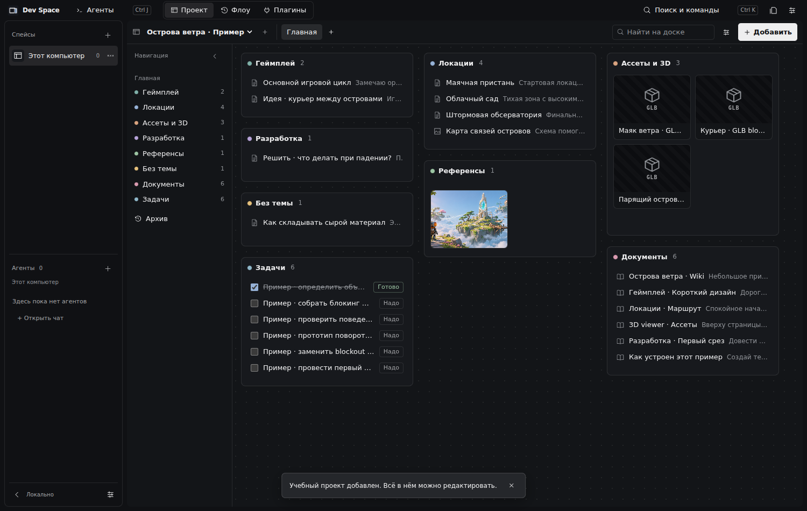 | 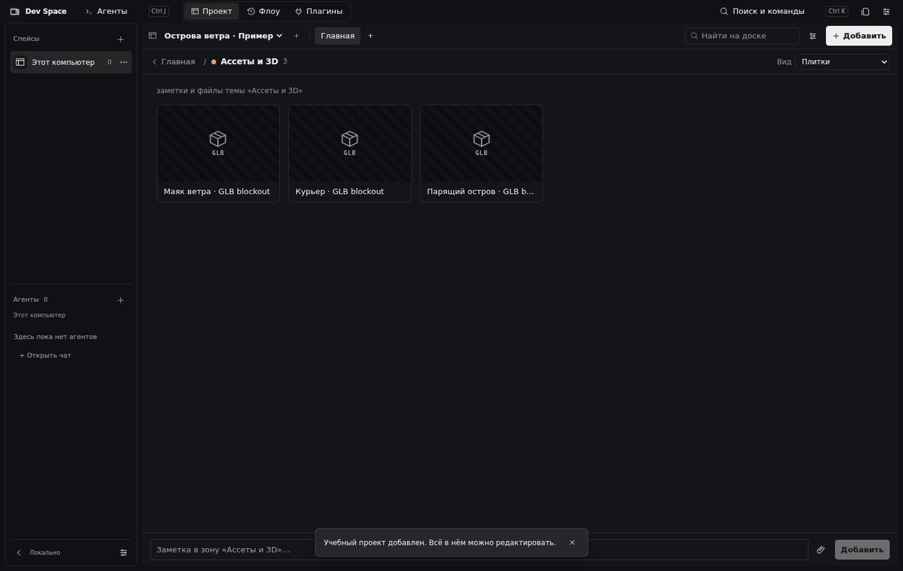 |
| 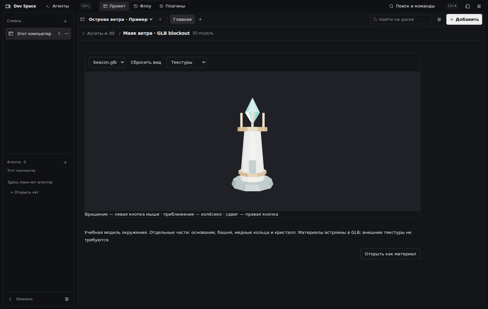 | 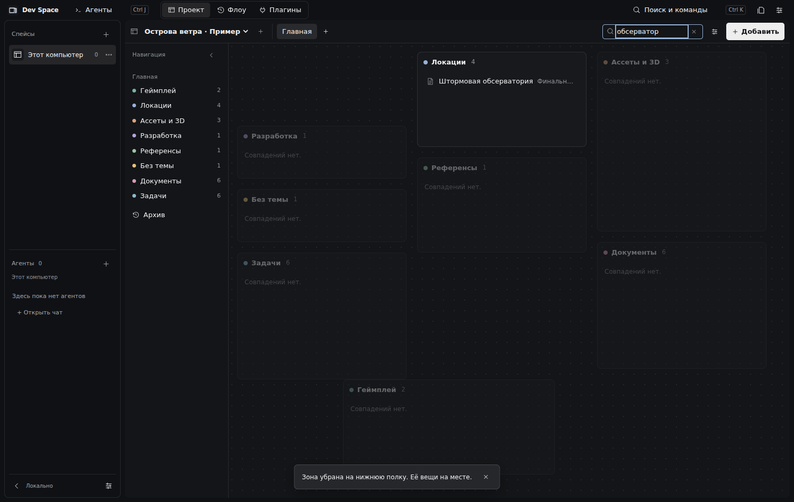 |
| 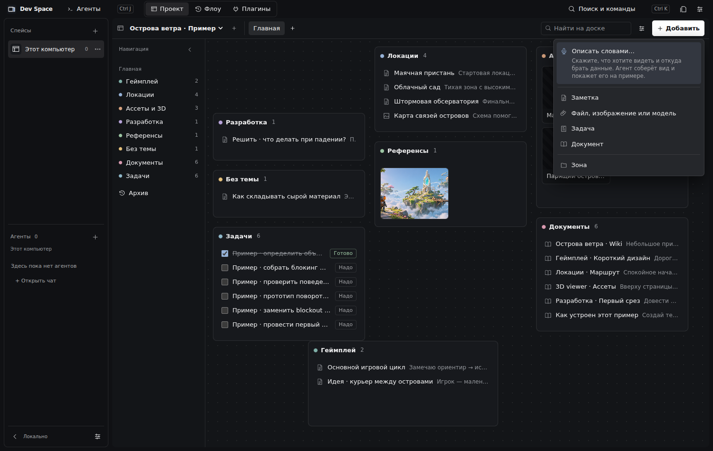 |  |
| 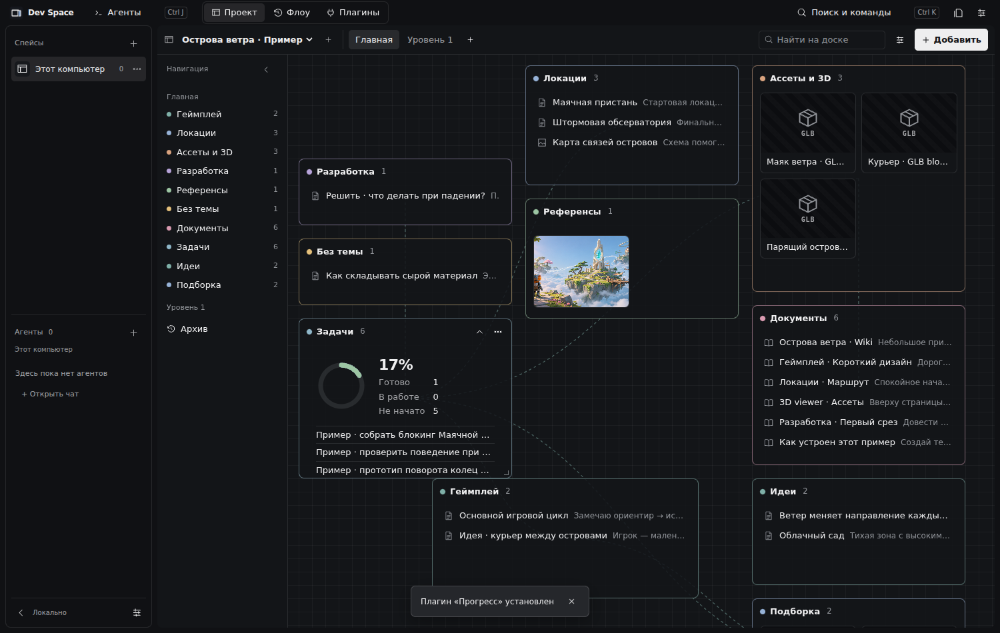 | 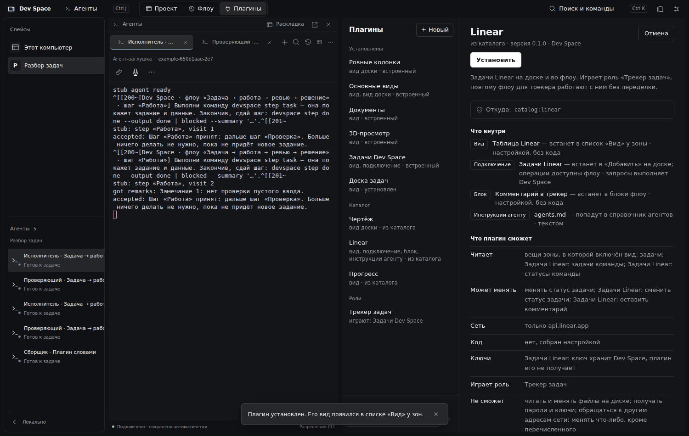 |
| 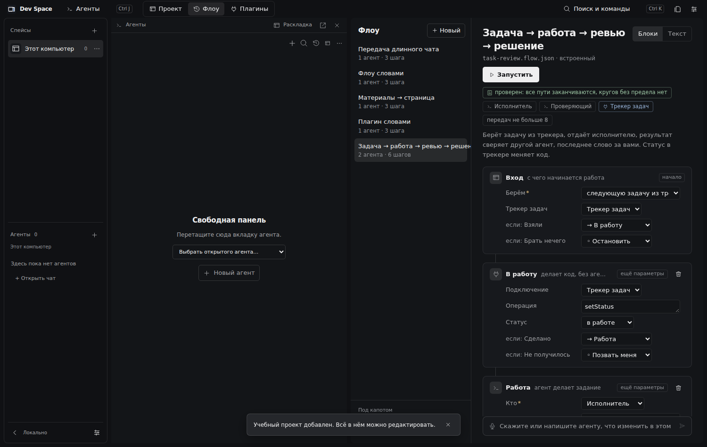 | 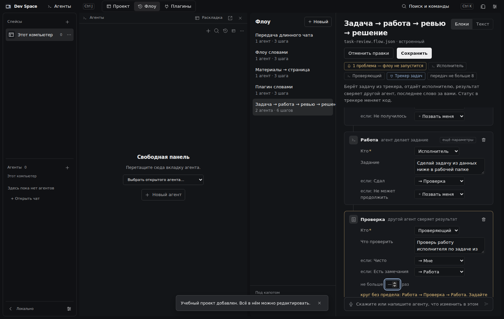 |
| 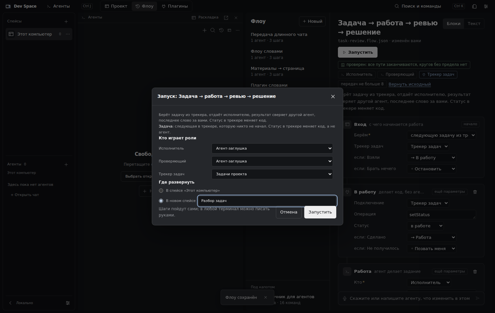 | 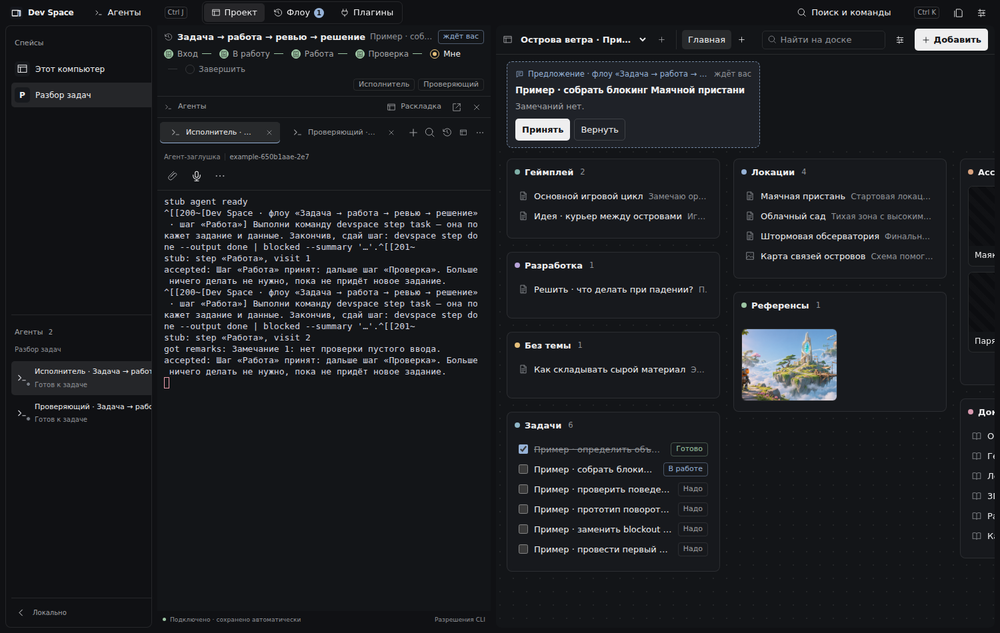 |
| 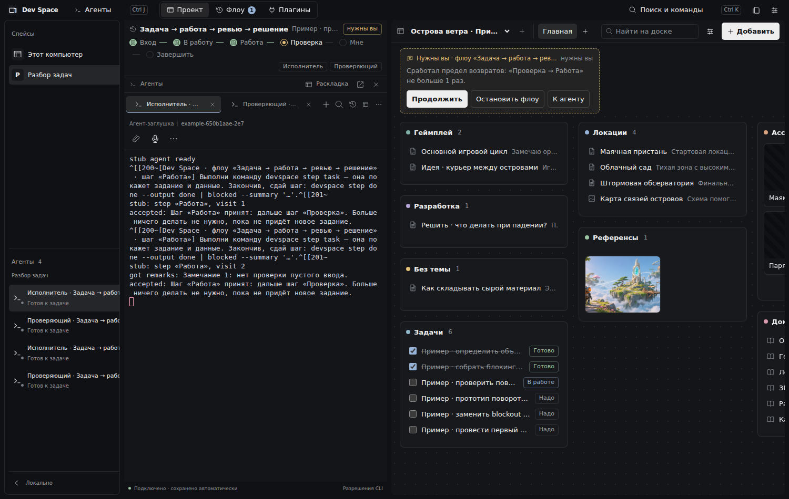 | 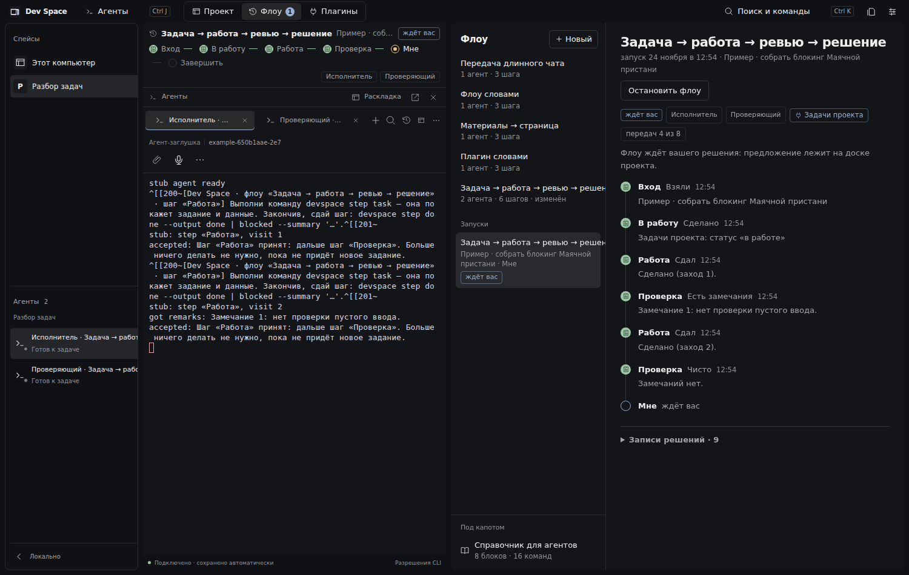 |
| 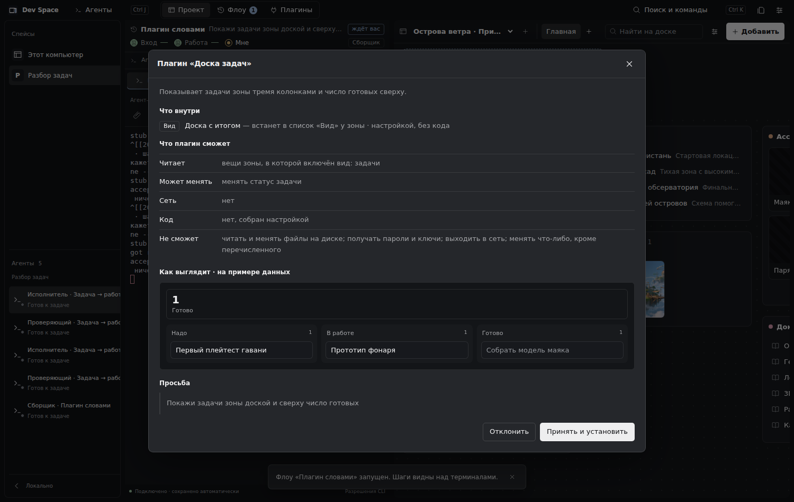 | 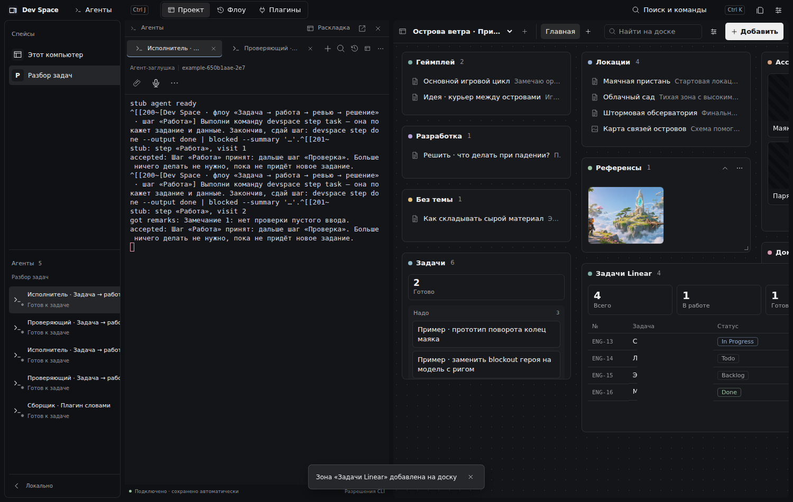 |

## Что не проверено и почему

- **Нативное окно Tauri, установщики, микрофон и распознавание речи.** На сервере нет экрана.
  Успешная сборка интерфейса этого не доказывает.
- **Linear с живым сервисом.** Ключа нет. Подключение написано по публичной документации и
  проверено на примерах ответов, составленных по ней; настоящие поля и ошибки могут отличаться.
- **Агент в обычном режиме прав.** Прогоны с настоящими агентами шли в их режиме без
  подтверждений, чтобы не отвечать на вопросы. Как Claude Code ведёт себя с галочкой «не
  спрашивать про `devspace`» и без неё — не проверено.
- **Codex в песочнице без сети.** Запасной файловый канал команды проверен только тестом, не
  настоящим Codex.
- **Флоу с двумя настоящими агентами**, OpenCode, Kimi, Antigravity, Windows и macOS.
- **Установка плагина по ссылке `https://`.** Проверена на локальном Git-репозитории.
- **Доска в мобильном виде, английский интерфейс новых экранов, большие проекты** (тысячи вещей).
- **Проверки интерфейса чатов** (`desktop:test:ui`): 12 из 13 падают на этом сервере и на этой
  ветке, и на нетронутом `main`. Причину не разбирал.
- **Баннер в начале README** остался прежним, со старым интерфейсом.

## Что ждёт вас

Полный список с вариантами — [OPEN-DECISIONS.md](OPEN-DECISIONS.md). Самое важное:

1. **Шаг флоу сам отправляет задание агенту.** Это расходится с прежним принципом «неотправленное
   задание остаётся в терминале»; для ручной передачи карточек принцип сохранён.
2. **Разрешение на команду `devspace`.** По умолчанию права агента не меняются; галочка в окне
   запуска разрешает Claude Code одну эту команду.
3. **Предложение страницы принимается и после других правок доски** — раньше отклонялось.
4. **Навигация проекта** — закреплённая панель слева от доски, её можно скрыть. Проект
   открывается на доске.
5. **Подключения без кода**: надёжно и безопасно, но без OAuth, постраничной выдачи и фонового
   слежения за новыми задачами.

## Дополнено 24 ноября по ревью из Qoyan

- **Записи решений.** Каждый выбор в запуске флоу пишется неизменяемой записью: что решалось, из
  чего выбирали, кто выбрал, по какому правилу и какой версии. Видно в «Флоу → запуск → Записи
  решений». Проверено тестом на цикле с пределом возвратов.
- **Навигация** возвращена как закреплённый вид слева от доски.
- **Модель задачи.** В ARCHITECTURE.md описано, как состояния запуска соотносятся с моделью задачи
  Qoyan, и чего пока нет (аренда, адреса между машинами).
- **Пользователь и игры.** Расхождение с решениями Qoyan от 13 ноября названо прямо
  (OPEN-DECISIONS, пункт 13): сначала ядро, сценарий для новичка — отдельной работой.

## Что бы я сделал следующим

1. Проверил в настоящем окне на Windows: перетаскивание, песочницу в WebView2, запуск флоу.
2. Проверил Linear с настоящим ключом и добавил GitLab (нужны разные запросы на смену статуса).
3. Фоновое слежение за событием «новая задача» и запуск флоу по нему.
4. Виды уровня «вещь» из сторонних плагинов и миниатюры 3D-моделей в плитках.
5. Перепроверку плагина на сохранённом примере данных при обновлении.
6. Запуск параллельных задач с отдельным спейсом на каждую и разделением экрана.
7. Английский интерфейс новых экранов и доску в мобильном виде.
